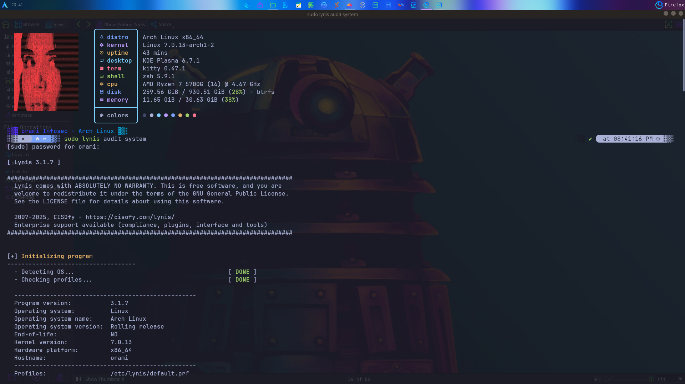
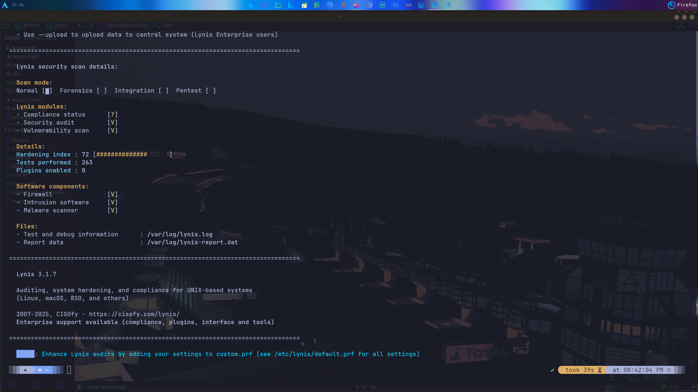
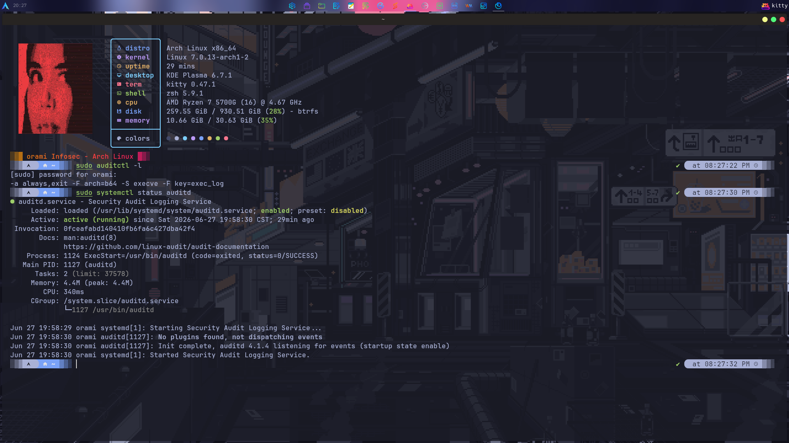
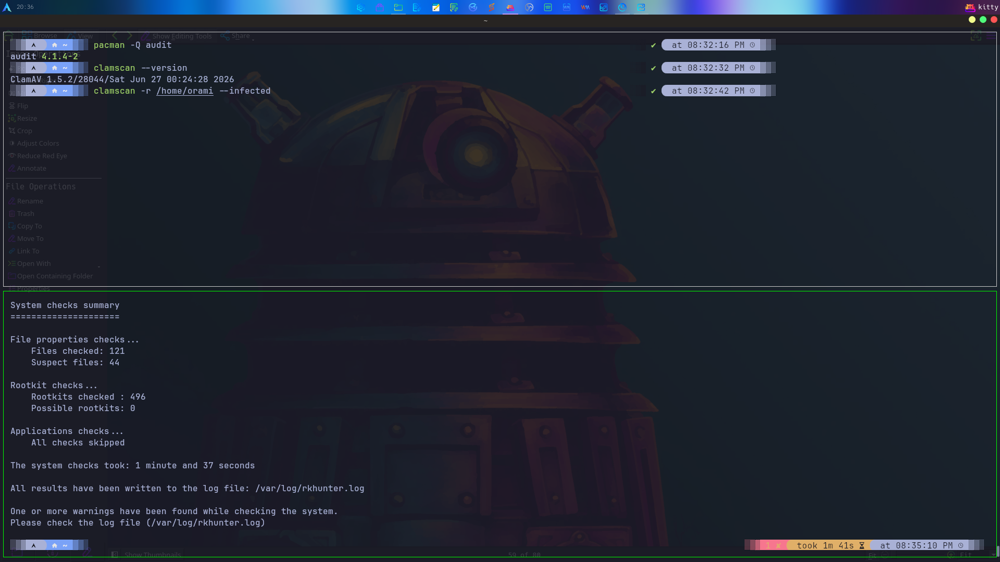

# System Hardening

Capturas de pantalla y documento sobre hardening de sistemas Linux.

## Contenido

### PDF

| Archivo | Descripcion |
|---------|-------------|
| `linux_hardening_report.pdf` | Reporte de hardening de Linux (5 paginas) |

### Imagenes

#### Lynis

*Escaneo con Lynis - resultados de auditoria de seguridad (1920x1080)*

*Escaneo con Lynis - resultados de auditoria de seguridad (1920x1080)*

*Escaneo con Lynis - resultados de auditoria de seguridad (1920x975)*

#### auditctl

*Configuracion de auditctl (auditd) para monitoreo del sistema (1920x1080)*

#### rkhunter

*Escaneo con rkhunter - deteccion de rootkits (1920x1080)*

#### UFW y Fail2ban

*Configuracion de UFW y Fail2ban para proteccion del firewall (1920x646)*

## Herramientas utilizadas

- **Lynis**: Escaner de auditoria de seguridad para sistemas Unix/Linux
- **auditctl**: Herramienta de linea de comandos para configurar reglas de auditd
- **rkhunter**: Escaner de rootkits para detectar malware y amenazas
- **UFW**: Uncomplicated Firewall - interfaz simplificada para iptables
- **Fail2ban**: Sistema de prevencion de intrusiones que bloquea IPs maliciosas
