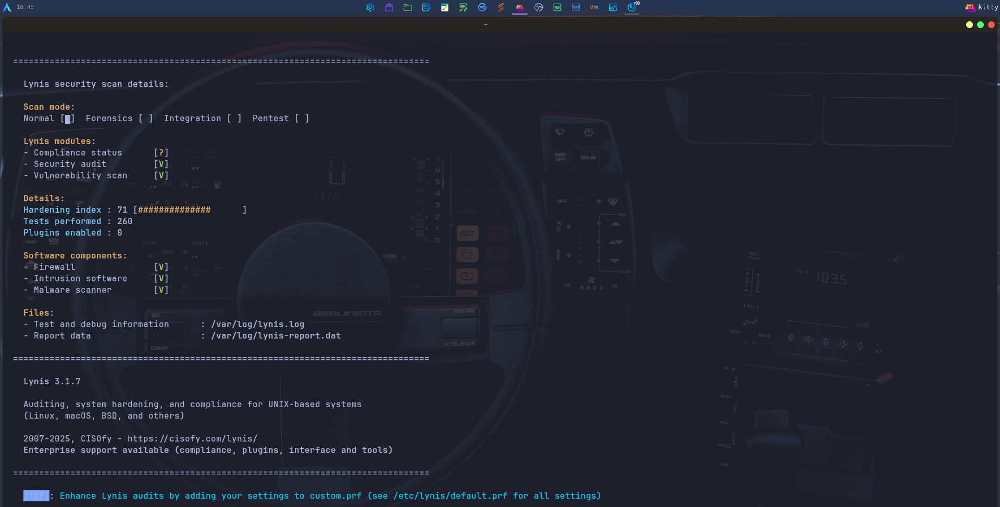
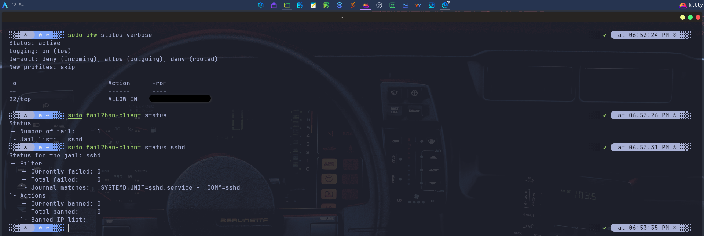

# System Hardening

Linux system's hardening - Arch Linux edition

## Tools used

### Lynis

Security auditing and hardening tool for Unix/Linux systems. Performs over 260 automated tests that evaluate system configuration, permissions, and active services, and generates a hardening score. The screenshots show a score of 71-72 out of 100, with the firewall, intrusion detection software, and malware scanner detected as active.




### UFW

Simple firewall. Simplified interface for iptables. The visible configuration denies all incoming traffic by default and allows SSH only from the local network.



### Fail2ban

Intrusion prevention tool. Monitors system logs and blocks IPs that make too many failed authentication attempts. In the screenshot, it is active with a cage configured for SSH, with no active locks at that time.

*(Included in the UFW screenshot)*

### rkhunter

Rootkit Hunter. A scanner that searches for rootkits, backdoors, and potential local vulnerabilities. It checks system file properties and signatures of known rootkits. The screenshot shows 496 rootkits checked, with none found, although it reports 44 suspicious files requiring manual review.


### ClamAV

Open-source antivirus for Linux. The command:

```bash
clamscan -r /home/orami --infected
```

recursively scans the home directory, displaying only infected files.

### auditctl / auditd

Linux kernel auditing daemon. Logs system events such as binary execution, file access, and system calls. The rule:

```bash
-a always,exit -F arch=b64 -S execve -F key=exec_log
```

logs the execution of every process on the system.


